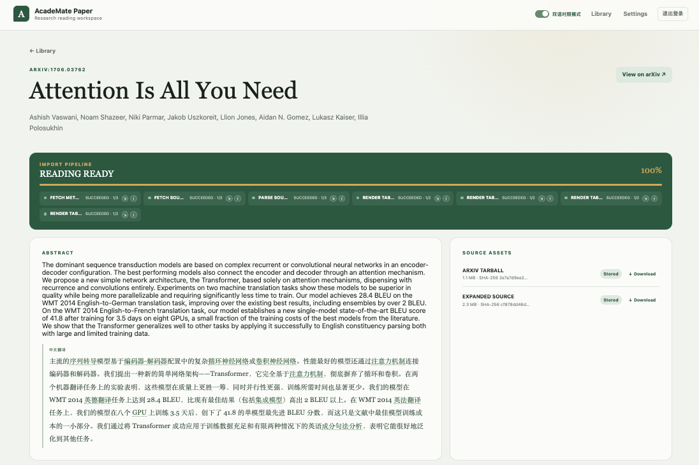
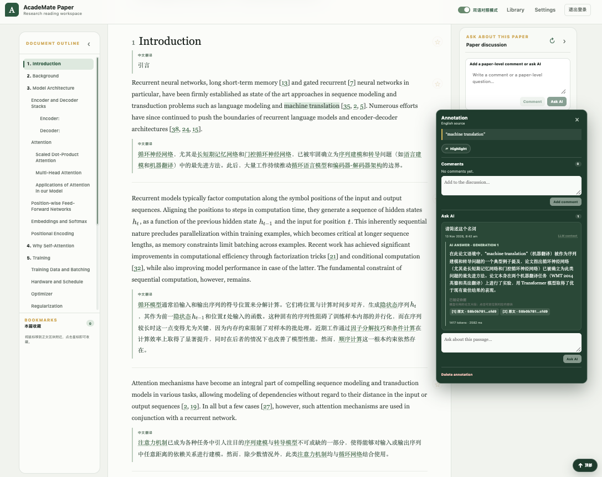
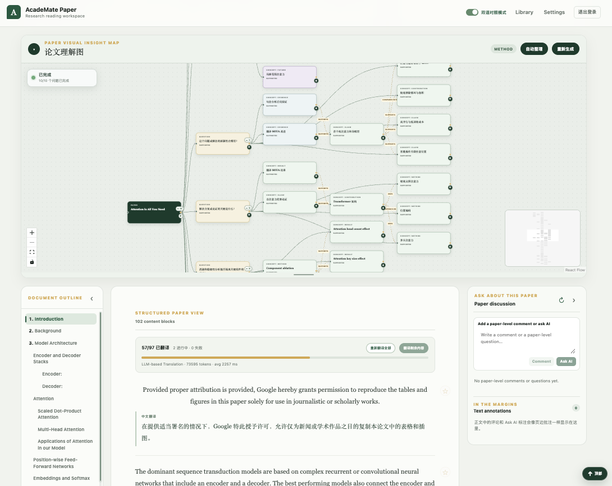

# AcadeMate Paper Server

1. **一份文库，多设备接续阅读。** AcadeMate Paper Server 是可自托管的论文阅读 API 服务，可部署在自己的电脑或云服务器上。联网阅读时，批注和阅读进度直接保存到服务器。换一台设备连接同一文库，即可接着读，无需手动同步。
2. **自带 Web 阅读器。** 用浏览器打开服务器地址，就能从 arXiv 导入论文、管理文库和阅读全文，无需安装客户端。
3. **围绕原文精读。** 自动生成论文理解图，按片段对照原文和译文。选中一句话，就能划线高亮、写批注，或用 Ask AI 针对这段原文提问。
4. **开放 API，支持第三方客户端。** Server 提供完整的 v2 OpenAPI 定义和可浏览的接口文档，开发者可以据此构建自己的客户端。官方 macOS 和 iOS 客户端正在开发中，计划近期开源。在此之前，可以直接使用内置 Web 端。

## 主要功能

以下用《Attention Is All You Need》展示一篇论文从导入到精读的过程。要使用翻译、AI 问答和论文理解图，可在设置中配置模型服务商和 API key。

### 从 arXiv 导入论文

粘贴 arXiv 链接或编号，后台会获取论文信息、下载源码并解析正文。详情页显示每一步的进度，也提供原始源码包下载。重复导入同一篇论文会直接打开已有记录。



### 对照原文精读，随手批注

沿章节目录浏览正文，打开双语模式即可逐段对照英文原文和中文译文。遇到想弄清楚的术语，可以选中它，高亮、写下笔记，或直接向 AI 提问。回答中的引用可以点开，回到对应的原文段落。



### 用理解图梳理论文思路

论文理解图把研究问题、方法和结论连起来。例如，读这篇论文时，可以沿着模型性能的分支找到支持结论的实验结果，点开节点中的引用，回到原文核对。



## 系统配置要求

两种安装方式首次安装时都需要联网下载依赖。

| 安装方式 | 系统与处理器 | 首次安装建议预留的可用空间 |
| --- | --- | --- |
| 直接安装 | macOS（Apple Silicon 或 Intel）或 Linux（ARM64 或 x86_64，glibc 2.28 及以上） | 安装目录所在磁盘 **20 GiB**，用于下载、解压和安装依赖 |
| Docker 容器安装 | 能运行 Linux 容器的 Docker 环境，例如 Linux 上的 Docker Engine 或 macOS 上的 Docker Desktop。支持 `linux/arm64` 和 `linux/amd64` | Docker 数据盘 **30 GiB**，用于从源码构建镜像及保存构建缓存 |

**CPU 与内存参考。** 直接安装已在 Apple Silicon Mac 和 Ubuntu ARM64 上完成验证。Ubuntu 测试机配置为 6 vCPU、8 GiB 内存，完成了论文导入、公式和图表渲染，可作为选择服务器规格的参考。

**磁盘占用参考。** Apple Silicon 上的全新直装实例约占 9.1 GiB，含安装缓存。Docker 的 v0.1.5 ARM64 镜像约为 7.4 GiB，构建时还会占用临时空间。两种方式都需要为后续导入的论文、渲染后的图表和备份另留空间。

## 部署

**两种安装方式任选其一。** 如果希望将服务直接装在 macOS 或 Linux 上，请选[安装方式 1](#安装方式-1macoslinux-直接安装)。如果使用 Docker，请选[安装方式 2](#安装方式-2docker-容器安装)。

新安装默认在所有可用网络接口提供 HTTPS，Web 端口为 `8443`，原生 App 的 API 端口为 `9443`。在服务器本机可用 `127.0.0.1`；在其他设备使用能到达服务器的 IP 或域名。例如服务器名为 `paper` 时，浏览器打开 `https://paper:8443`，App 填写 `https://paper:9443`。服务按端口区分 Web 与 API，新增访问地址无需登记。

克隆仓库并进入源码目录，或下载源码压缩包后解压。以下命令均从仓库根目录执行。

```sh
git clone https://github.com/friskit-china/academate-paper-server.git
cd academate-paper-server
```

### 安装方式 1：macOS/Linux 直接安装

以日常用户运行安装向导，选择一个由自己拥有的空目录。默认位置为 `~/AcadeMatePaper`。首次安装需联网下载 Python、Node、完整 TeX Live、字体等依赖并构建 Web，请预留下载时间和磁盘空间。运行时、数据及安装缓存都会放在所选目录内。

```sh
./deploy/native-install/install.sh
```

安装完成后，打开向导打印的一次性 HTTPS 链接，为个人账号 `admin` 设置至少 12 个字符的密码。以后登录只需密码。如需新的设置链接，请运行 `"$HOME/AcadeMatePaper/bin/setup-url"`。如果浏览器提示证书不受信任，请参阅[可选步骤：信任证书](#可选步骤信任证书)。

向导默认将 `amp` 链接放在 `~/.local/bin`。若终端找不到该命令，可将这个目录加入当前 shell 的 PATH。

```sh
export PATH="$HOME/.local/bin:$PATH"
amp status
```

以下示例显式选择安装目录、命令目录和端口。

```sh
./deploy/native-install/install.sh \
  --prefix "$HOME/AcadeMatePaper" --bin-dir "$HOME/.local/bin" \
  --web-port 8443 --api-port 9443
```

安装向导需要 POSIX shell、curl 和 SHA-256 校验工具。解压步骤可以使用支持 bzip2 的 tar 或系统已有的 Python 3。

### 安装方式 2：Docker 容器安装

在仓库根目录启动 Docker Compose。它从源码构建镜像，创建 `acade-paper` 容器，在宿主网络接口发布 Web 和 API，并用 `acade-paper-data` 卷保存实例数据。

```sh
docker compose up -d --build
```

安装时选用自己的域名与端口，例如 `WEB_HOST=paper.home.arpa WEB_PORT=8543 API_PORT=9543 docker compose up -d --build`。将域名换成客户端可解析的名称。`API_HOST` 默认与 `WEB_HOST` 相同，两者都只填写主机名或 IP，IPv6 地址使用方括号。要把两个入口限制在本机，使用 `BIND_HOST=127.0.0.1 SERVER_HTTPS_ANY_HOST=false docker compose up -d --build`。后续重新创建时请继续使用同样的参数，也可以将它们保存到 Compose 的 `.env` 文件。

也可以直接使用 Docker CLI，效果与默认 Compose 配置相同。

```sh
docker build -f Dockerfile.server -t academatepaper/server:local . && \
docker run -d --name acade-paper --restart unless-stopped --stop-timeout 45 \
  -p 8443:8443 -p 9443:9443 \
  --mount type=volume,source=acade-paper-data,target=/data \
  academatepaper/server:local
```

用 `docker inspect -f '{{.State.Health.Status}}' acade-paper` 查看启动状态。出现 `healthy` 后，运行以下命令，打开终端输出的一次性 HTTPS 链接设置密码。如果浏览器提示证书不受信任，请参阅[可选步骤：信任证书](#可选步骤信任证书)。

```sh
docker exec -it acade-paper python -m app.container_entry setup prepare-container-setup
```

后续从浏览器打开 `https://127.0.0.1:8443`。运行 `docker exec -it acade-paper sh` 可进入容器使用 `amp`，也可以直接运行 `docker exec acade-paper amp status`。若容器本身已停止，在宿主机运行 `docker start acade-paper`。

### 可选步骤：信任证书

如果浏览器已信任服务器证书，可以跳过本节。默认安装会创建实例专用的根证书（CA）。要让浏览器信任它，请按下方说明导出根证书，并在使用浏览器的设备上导入。访问时使用的域名或 IP 也应在服务证书的覆盖范围内。

在新版 **AcadeMate Paper App** 中，可直接输入原生 API 地址（本机默认 `https://127.0.0.1:9443`）。首次遇到未受信的证书时，核对 App 显示的地址和 SHA-256 指纹后即可在 App 内信任，无需修改系统信任库。此选择只适用于当前服务器地址和端口。若证书与已记住的身份不再匹配，App 会要求重新确认。App 按输入的协议连接，显式使用 `http://` 时密码和会话会以明文传输。

在服务器上按所选安装方式导出公开的根证书。**直接安装**使用以下命令（以默认目录为例）。

```sh
cp "$HOME/AcadeMatePaper/data/https/caddy/pki/authorities/local/root.crt" ./academate-paper-ca.crt
```

**Docker 容器安装**使用以下命令。

```sh
docker cp acade-paper:/data/https/caddy/pki/authorities/local/root.crt ./academate-paper-ca.crt
```

将导出的 `academate-paper-ca.crt` 复制到需要信任它的设备，再按系统导入。

- macOS：在「钥匙串访问」将证书导入「登录」钥匙串，打开证书，在「信任」里将 SSL 设为「始终信任」。
- Ubuntu / Debian：运行 `sudo install -m 0644 academate-paper-ca.crt /usr/local/share/ca-certificates/academate-paper-ca.crt`，再运行 `sudo update-ca-certificates`。
- iPhone / iPad：通过可信渠道将证书传到设备，安装描述文件后，到「设置 → 通用 → 关于本机 → 证书信任设置」对该根证书启用完全信任。其他系统或使用独立信任库的客户端，请将同一根证书导入其受信任的根证书库。

也可只为单次命令指定根证书，验证原生 API 的 HTTPS 连接：

```sh
curl --cacert ./academate-paper-ca.crt https://127.0.0.1:9443/api/v2/server/info
```

## 服务 CLI

| 命令 | 用途 |
| --- | --- |
| `amp start` | 启动服务 |
| `amp stop` | 停止服务，包括正在运行的 worker |
| `amp restart` | 重启服务 |
| `amp status` | 查看服务和子进程状态、worker 最近心跳及处理容量 |
| `amp resume` | 将执行中断且已失去有效 worker 的任务重新加入队列，可重复执行 |
| `amp passwd` | 在终端修改个人账号密码 |

## HTTPS 与其他设备访问

新安装默认按两个不同的 HTTPS 端口接受任意域名和 IP。DNS 或 Tailscale MagicDNS 需能在客户端解析该名称。使用 Tailscale 时，客户端应连接同一 tailnet，并有权访问对应端口。Docker 的 IPv4 和 IPv6 可达性取决于引擎和宿主机的网络配置。

**已有实例启用全地址监听。** 直装从实例目录运行 `./bin/amp stop && ./bin/configure-https --any-host && ./bin/amp start`。Docker 使用原数据卷和其他设置重新创建容器，发布 `-p 8443:8443 -p 9443:9443` 并设置 `-e SERVER_HTTPS_ANY_HOST=true`。

**仅允许本机访问。** 新直装实例使用默认的两个回环主地址并加 `--no-any-host`。Docker 把发布参数改为 `-p 127.0.0.1:8443:8443 -p 127.0.0.1:9443:9443`。如还需限制可用主机名，在 Docker 中设置 `-e SERVER_HTTPS_ANY_HOST=false`。

**设置证书名称和端口。** 下面用 `paper.home.arpa` 的 `8543` 端口提供 Web、`9543` 端口提供 API，同时将 `127.0.0.1` 纳入实例自动签发的证书。将示例域名换成客户端能解析的域名或服务器的局域网 IP。

直装时可直接把以下地址参数传给安装向导。已有实例从安装目录运行以下命令。

```sh
cd "$HOME/AcadeMatePaper"
./bin/amp stop
./bin/configure-https \
  --web-origin https://paper.home.arpa:8543 --api-origin https://paper.home.arpa:9543 \
  --web-aliases https://127.0.0.1:8543 --api-aliases https://127.0.0.1:9543
./bin/amp start
```

Docker 用户使用同一镜像。更改已有容器时，按下一节备份后重新创建容器并挂回原卷。

```sh
docker run -d --name acade-paper --restart unless-stopped --stop-timeout 45 \
  -p 8543:8543 -p 9543:9543 \
  -e WEB_PUBLIC_ORIGIN=https://paper.home.arpa:8543 \
  -e SERVER_HTTPS_API_ORIGIN=https://paper.home.arpa:9543 \
  -e SERVER_HTTPS_WEB_ALIASES=https://127.0.0.1:8543 \
  -e SERVER_HTTPS_API_ALIASES=https://127.0.0.1:9543 \
  --mount type=volume,source=acade-paper-data,target=/data \
  academatepaper/server:local
```

别名参数接受以逗号分隔的完整 HTTPS 地址。每项填写 `https://主机名或IP:端口`，使用 443 时可以省略端口。默认模式下，Web 和 API 各自占用不同端口。若别名使用额外端口，Docker 也要为每个新增端口添加 `-p`。例如增加 Web 别名 `https://reader.home.arpa:10443` 时，要同时增加 `-p 10443:10443`。

实例自动签发的证书支持多个域名和一个字面 IP 地址，该 IP 可以出现在多个端口。若需同时用两个不同的 IP 连接（例如 `127.0.0.1` 和 `192.168.1.10`），请按下段提供一张同时覆盖这两个 IP 及所用域名的证书。使用局域网域名搭配回环 IP 时可直接使用自动签发。

**使用已有证书**时，在安装向导或 `configure-https` 命令后同时加上 `--cert /absolute/path/fullchain.pem --key /absolute/path/privkey.pem`。Docker 则在 `docker run` 增加 `--mount type=bind,source=/absolute/path/tls,target=/tls,readonly`、`-e SERVER_HTTPS_CERT_FILE=/tls/fullchain.pem` 和 `-e SERVER_HTTPS_KEY_FILE=/tls/privkey.pem`。证书的 SAN 应覆盖两个入口及全部别名使用的主机名和 IP，容器服务用户（UID 10001）需要读取私钥的权限。替换证书后请运行 `amp restart`。

**使用公网 CA** 时，可给 Web、API 设置不同的可解析公网域名。若两者共用 HTTPS 端口 443，直装增加 `--acme --no-any-host`，Docker 增加 `-e SERVER_HTTPS_MODE=acme -e SERVER_HTTPS_ANY_HOST=false` 并发布 `-p 443:443`。此模式需要公网能访问 443，直装服务账号也需要监听该端口的权限。

升级已有实例时，直装恢复原配置，Docker 使用原数据卷和原启动参数会保留其协议。仍需本机 HTTP 的新直装实例可显式选择 `--http-loopback`。Docker 可显式设置 `-e WEB_PUBLIC_ORIGIN=http://127.0.0.1:3000` 并只发布 `-p 127.0.0.1:3000:3000 -p 127.0.0.1:8000:8000`。

## 备份、升级和卸载

直装备份应包含原安装的整个 `data/` 目录和 `instance.json`，后者保存解密模型凭据所需的实例密钥。先停止服务，再将两者复制到安装目录之外的私有目录。以下示例同时演示从备份升级；请在拿到新版源码后，从新版仓库根目录执行安装命令。

```sh
"$HOME/AcadeMatePaper/bin/amp" stop
backup_dir=$(mktemp -d "$HOME/AcadeMatePaper-backup.XXXXXXXX")
cp -Rp "$HOME/AcadeMatePaper/data" "$HOME/AcadeMatePaper/instance.json" "$backup_dir/"
./deploy/native-install/install.sh \
  --prefix "$HOME/AcadeMatePaper-next" --bin-dir "$HOME/AcadeMatePaper-next/bin" \
  --restore-from "$backup_dir"
```

确认新实例的文库、批注和阅读进度后，用新目录下的 `bin/amp` 管理服务。只做备份时，复制完成后启动原实例即可。要永久卸载某一实例，运行下面的命令，核对范围后输入向导显示的完整目录。确认后，该目录内的代码、数据和密钥将被永久删除。

```sh
./deploy/native-install/install.sh --uninstall --prefix "$HOME/AcadeMatePaper"
```

使用 Docker 时，先停止容器，再备份完整数据卷，包括隐藏文件 `.amp-instance.json`。以下示例将备份保存到当前用户的私有目录。

```sh
docker stop acade-paper
backup_dir=$(mktemp -d "$HOME/AcadeMatePaper-backup.XXXXXXXX")
docker run --rm --network none --entrypoint tar \
  --mount type=volume,source=acade-paper-data,target=/data,readonly \
  academatepaper/server:local -C /data -czf - . > "$backup_dir/data.tar.gz"
```

只做备份时执行 `docker start acade-paper`。升级时，从新版源码重新构建镜像，用 `docker rm acade-paper` 移除已停止的容器，然后按原有端口、证书和数据卷参数重新创建。同一份数据在任一时刻只应由一个 Server 写入。要永久卸载，请在确认备份可用后停止并移除容器，再执行 `docker volume rm acade-paper-data` 删除全部实例数据；本机镜像可用 `docker image rm academatepaper/server:local` 移除。

## API

登录后可在 Web 设置中打开接口查看器，按路径或 HTTP 方法查看当前实例的接口和数据结构。程序可以使用自己的设备会话从 `/api/v2/openapi.json` 读取同一份 OpenAPI 定义。

## 许可证

MIT License

Copyright (c) 2026 AcadeMate Paper Server contributors

Permission is hereby granted, free of charge, to any person obtaining a copy
of this software and associated documentation files (the "Software"), to deal
in the Software without restriction, including without limitation the rights
to use, copy, modify, merge, publish, distribute, sublicense, and/or sell
copies of the Software, and to permit persons to whom the Software is
furnished to do so, subject to the following conditions:

The above copyright notice and this permission notice shall be included in all
copies or substantial portions of the Software.

THE SOFTWARE IS PROVIDED "AS IS", WITHOUT WARRANTY OF ANY KIND, EXPRESS OR
IMPLIED, INCLUDING BUT NOT LIMITED TO THE WARRANTIES OF MERCHANTABILITY,
FITNESS FOR A PARTICULAR PURPOSE AND NONINFRINGEMENT. IN NO EVENT SHALL THE
AUTHORS OR COPYRIGHT HOLDERS BE LIABLE FOR ANY CLAIM, DAMAGES OR OTHER
LIABILITY, WHETHER IN AN ACTION OF CONTRACT, TORT OR OTHERWISE, ARISING FROM,
OUT OF OR IN CONNECTION WITH THE SOFTWARE OR THE USE OR OTHER DEALINGS IN THE
SOFTWARE.
